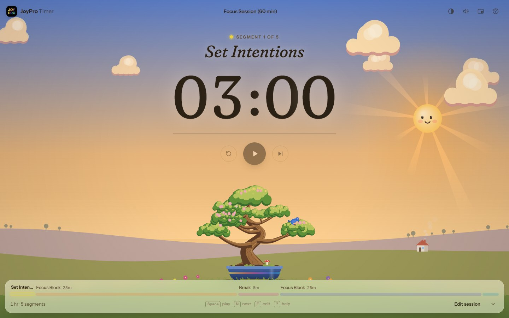
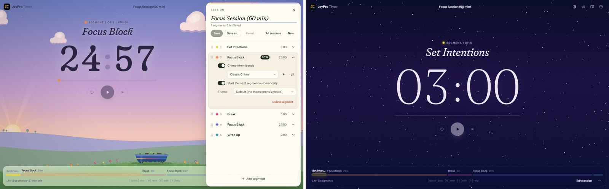

# JoyPro Timer Reloaded

A coworking session timer for Joyful Productivity. A session is a run of timed segments, from Set Intentions through focus blocks and breaks to Wrap Up. This is a ground-up rebuild of the [JoyPro Timer](https://github.com/capeably/JoyPro-Timer): every feature of the original, with a new design.

**[Open JoyPro Timer Reloaded →](https://capeably.github.io/JoyPro-Timer-Reloaded/)** It runs in your browser, with nothing to install.



## A day for every segment

In the Growing Tree theme, each segment is one storybook day. At dawn a sprout pokes out of its pot, and a bonsai grows as the segment runs. It blossoms at golden hour, then night falls with fireflies, an owl and a sleepy moon. Along the way a bluebird drops by, butterflies drift past, and the sun peeks in to check on you. Every segment grows a tree of its own.


## What it does

- **Sessions of segments,** each with its own length, chime and theme, and the choice to start the next one automatically.
- **One editor for everything:** rename, reorder or add segments, and change their lengths, sounds and themes. Save, save as or revert, and keep as many sessions as you like.
- **The whole session at a glance:** a ribbon along the bottom sizes each segment by its length and shows the time left and when you'll finish.
- **A mini timer** that floats above your other windows in Chrome and Edge, with play, pause and skip.
- **On time in the background:** chimes and auto-advance keep to the clock when the tab is hidden, and the screen stays awake while the timer runs.
- **Four themes:** Growing Tree, Starry Night, Light and Dark. Pick one for everything, or give a segment its own.
- **Your own chimes:** add MP3 or WAV files to the Sound Library.
- **Import and export** sessions as JSON, in the same format as the original app.
- **Keyboard shortcuts:** Space plays or pauses, N skips ahead, R resets, E opens the editor, M mutes, P opens the mini timer and ? shows help.



Your sessions and sounds stay in your browser: there's no account, and nothing you save leaves your computer. If you've used the original JoyPro Timer in the same browser, your sessions, settings and sounds come across on your first visit, and the original's data is left as it was.

## Run it yourself

Download the repository and open `index.html`. There's no build step and nothing to install.

The tests need [Node.js](https://nodejs.org/) 22 or later, and Chrome or Edge for the browser checks:

```sh
node tests/core.test.js
node tests/shoot.js
```

The first runs the timer's logic tests. The second drives a headless browser through every theme and flow, and saves screenshots to `_Workbench/_Inbox/shots/`.

## About this rebuild

Like the original, JoyPro Timer Reloaded was made with Claude. It was designed and written from a blank page in Claude Code in November 2026. `CLAUDE.md`, `__Context/` and `ROADMAP.md` are the working notes Claude keeps for the project, and `_Reference/` holds the feature parity checklist and these screenshots.
